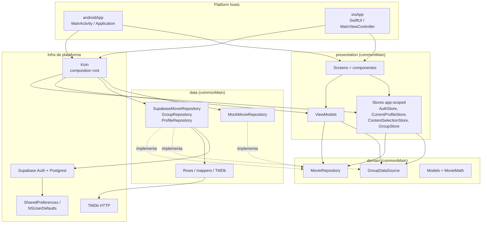
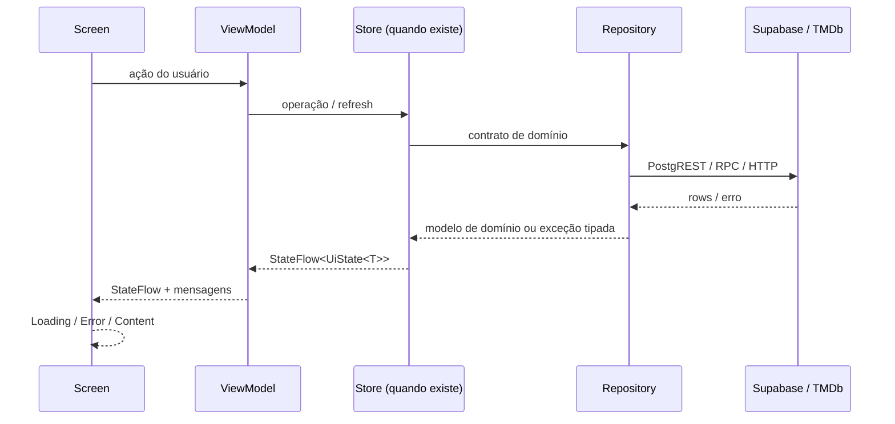
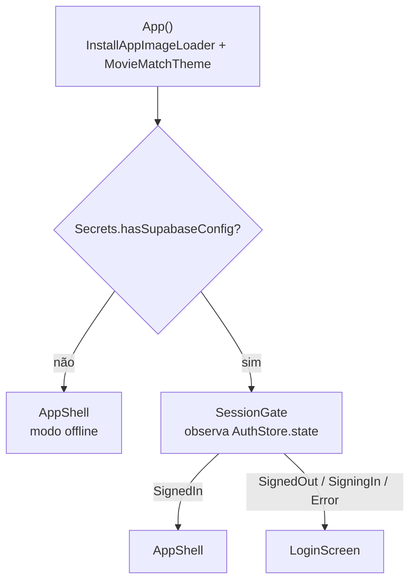
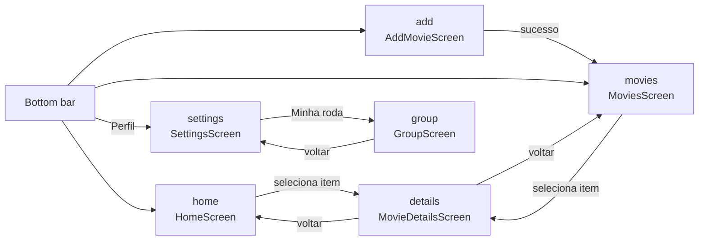
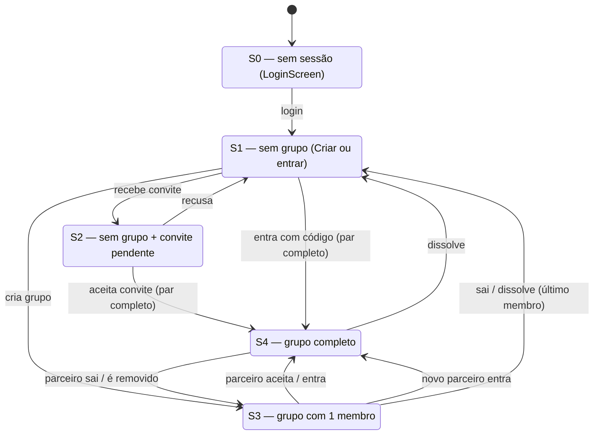
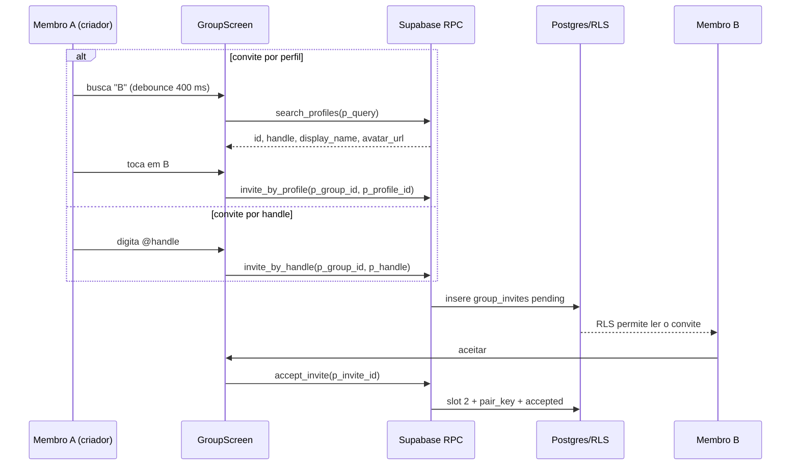
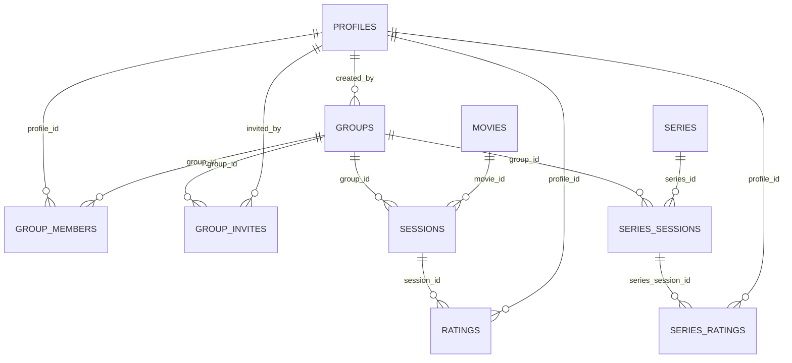
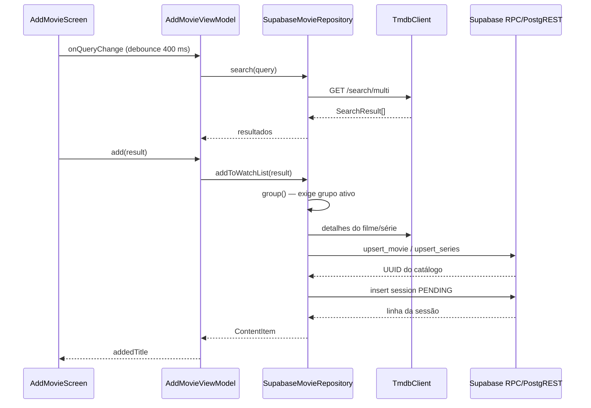

# Arquitetura — MovieMatchApp

> **Documento canônico da arquitetura atual.**  
> Última revisão: **19/10/2026**  
> Método: análise estática do código, dos builds e das migrações SQL do repositório.  
> Build, testes e execução em device **não** foram rodados durante esta revisão.

Este documento descreve o que o repositório implementa hoje. Ele não é um changelog nem um plano de produto. Decisões já superadas estão isoladas na seção [Documentos históricos e conteúdo superseded](#18-documentos-históricos-e-conteúdo-superseded).

---

## 1. Visão geral

MovieMatch é um app **Kotlin Multiplatform + Compose Multiplatform** para Android e iOS. O produto organiza uma “roda” de duas pessoas que compartilham uma lista de filmes e séries, marcam o que já assistiram e dão notas de 0 a 10.

O escopo implementado inclui:

- login com Google via Supabase Auth (Android implementado; iOS é stub);
- criação, entrada, convite, saída e dissolução de uma roda de no máximo dois membros;
- catálogo global de filmes/séries alimentado pelo TMDb;
- lista da roda (`PENDING`/`WATCHED`), nota individual e média do casal;
- modo offline com dados semeados quando não há credenciais Supabase;
- UI compartilhada em Compose, Material Design 3 com tema claro/escuro e cor dinâmica (Material You), e navigation bar edge-to-edge.

O escopo ainda **não** inclui consumo de Realtime, deep links, cancelamento de convite enviado, login Google no iOS, i18n formal ou acessibilidade validada em device. Esses itens aparecem como dívidas/riscos nas seções finais.

### 1.1 Princípios observados

1. **Uma única implementação de UI** em `commonMain`; Android e iOS fornecem apenas o host e os `actual` de plataforma.
2. **Contratos no domínio** (`MovieRepository`, `GroupDataSource`) e implementações de dados substituíveis (Supabase ou mock).
3. **Regras de escrita sensíveis no banco** por RPCs `SECURITY DEFINER`; o cliente não escreve diretamente em grupos, membros, convites nem no catálogo.
4. **Estado compartilhado app-scoped** para sessão, perfil atual e roda, em vez de recarregar cada tela ao voltar.
5. **Falha explícita e em português** na UI; estados `Loading`/`Error`/`Content` padronizados.
6. **Offline como caminho de primeira classe**, não como exceção: sem `.env`, o app abre o shell com dados mock.

---

## 2. Stack e versões

Versões declaradas em `gradle/libs.versions.toml`, `gradle/wrapper/gradle-wrapper.properties` e builds de módulo.

| Componente | Versão | Observação |
| :--- | :--- | :--- |
| Gradle | 9.6.1 | wrapper |
| Android Gradle Plugin | 9.1.1 | `androidApplication` e `androidMultiplatformLibrary` |
| Kotlin | 2.4.10 | KMP, serialization e Compose compiler |
| Compose Multiplatform | 1.11.1 | UI compartilhada |
| Compose Material 3 | 1.11.0-alpha07 | artefato multiplataforma |
| Navigation Compose (KMP) | 2.9.2 | rotas em `commonMain` |
| AndroidX Activity | 1.11.0 | host Android |
| Lifecycle (KMP) | 2.11.0 | ViewModel e `collectAsStateWithLifecycle` |
| Ktor | 3.5.1 | HTTP do TMDb e engines Supabase |
| supabase-kt | 3.8.0 | Auth + Postgrest instalados |
| Koin | 4.2.2 | DI e `koinViewModel` |
| Coil3 | 3.5.0 | imagens; fetcher Ktor explícito |
| Material 3 | 1.11.0-alpha07 | tema, componentes e tokens (com Material You no Android 12+) |
| kotlinx-coroutines | 1.11.0 | — |
| kotlinx-serialization | 1.11.0 | JSON/rows |
| kotlinx-datetime | 0.8.0 | data atual em `saveRating` |
| multiplatform-settings | 1.3.0 | sessão em `SharedPreferences`/`NSUserDefaults` |
| Credential Manager | 1.6.0 | Google Sign-In Android |
| Google ID | 1.2.1 | `GoogleIdTokenCredential` |
| Turbine | 1.2.1 | testes de Flow |
| JDK / jvmTarget | 17 | Android |
| compileSdk / targetSdk | 37 | piso definido por lifecycle 2.11.0 |
| minSdk | 24 | Android |
| Targets iOS | `iosArm64`, `iosSimulatorArm64` | framework estático `Shared` |

Não há target desktop ou web.

---

## 3. Módulos e diretórios

```text
MoviematchApp/
├── androidApp/                     # host Android (Activity + Application + recursos)
├── iosApp/                         # host SwiftUI + projeto Xcode
├── shared/                         # todo o código compartilhado
│   └── src/
│       ├── commonMain/kotlin/app/moviematch/
│       │   ├── App.kt              # raiz Compose + SessionGate
│       │   ├── Platform.kt         # expect platformName()
│       │   ├── auth/               # AuthStore, AuthState, GoogleSignIn (expect)
│       │   ├── data/
│       │   │   ├── mock/           # MockData + MockMovieRepository
│       │   │   └── supabase/       # cliente, repositórios, rows, TMDb
│       │   ├── di/                 # módulos Koin e composição
│       │   ├── domain/             # contratos + modelos + regras puras
│       │   │   └── model/Models.kt
│       │   └── presentation/
│       │       ├── addmovie/       # busca/adicionar título
│       │       ├── common/         # stores, UiState, Coil, formatadores
│       │       ├── components/     # design system compartilhado
│       │       ├── details/        # detalhe, notas, exclusão
│       │       ├── group/          # GroupStore/VM/Screen
│       │       ├── home/           # bento grid + cards
│       │       ├── login/          # LoginScreen/VM
│       │       ├── movies/         # lista + cards
│       │       ├── navigation/      # rotas, shell, bottom bar
│       │       ├── settings/       # perfil, avatar, card da roda
│       │       └── theme/          # cores, dimensões, tipografia
│       ├── androidMain/            # actuals Android + Koin com Context
│       ├── iosMain/                # actuals iOS + MainViewController
│       └── commonTest/             # 118 testes de host JVM
├── supabase/
│   ├── 0001_init.sql               # schema, RLS, RPCs, realtime
│   ├── 0002_group_join_by_code.sql # join_group_by_code
│   ├── 0003_remove_member.sql       # remove_member
│   └── 0004_fix_group_lifecycle.sql # lifecycle de grupo/convite + índices parciais
├── .env.example                    # template versionado
└── ARCHITECTURE.md                 # este documento
```

O arquivo `app.moviematch.config.Secrets` **não é versionado**: é gerado em build a partir do `.env` pelo task `generateSecrets`.

---

## 4. Camadas e regra de dependência

### 4.1 Visão das camadas



### 4.2 Direção pretendida

- `domain/`: contratos e modelos sem dependência de Compose, Supabase ou HTTP. As regras puras de `MovieMath.kt` também vivem aqui.
- `data/`: implementações dos contratos, rows `@Serializable`, mapeadores e acesso a Supabase/TMDb. Depende de `domain`.
- `presentation/`: telas, ViewModels e stores. Depende de `domain`; não deveria depender de detalhes de `data`.
- `auth/`: dono da sessão Supabase; faz a ponte entre Auth, `CurrentProfileStore` e o restante do app.
- `di/`: composition root do Koin, única camada que conhece todas as implementações.
- `androidMain`/`iosMain`: `expect`/`actual` de engine HTTP, armazenamento, Google Sign-In e host da UI.

### 4.3 Vazamentos de camada presentes no código

A regra acima é a direção arquitetural, mas o código atual tem acoplamentos que precisam ser considerados ao evoluir:

| Origem | Dependência | Efeito |
| :--- | :--- | :--- |
| `presentation/group/GroupStore.kt` | `data.supabase.GroupRepositoryException` | Store de apresentação conhece exceção concreta de dados. |
| `auth/AuthStore.kt` | `data.supabase.profileById` | Auth compartilhado usa função de leitura do Supabase. |
| `presentation/settings/SettingsViewModel.kt` | `data.supabase.ProfileRepository`, `AVATAR_URL_FORMAT_ERROR`, `isAvatarUrlValid` | ViewModel importa validação e escrita concretas. |
| `data/supabase/ProfileRepository.kt` | `presentation.common.CurrentProfileStore` | Camada de dados escreve em store de apresentação. |

Esses pontos não impedem o funcionamento, mas reduzem a testabilidade e tornam a regra de dependência apenas parcialmente aplicada. Não há módulos Gradle separados para `domain`/`data`/`presentation`; a separação é por pacotes dentro de `shared`.

### 4.4 Fluxo de dados padrão



---

## 5. Entrada do app, sessão e modo offline

### 5.1 Hosts de plataforma

- **Android**
  - `MovieMatchApplication.onCreate()` chama `initKoin(application)`, registrando o `Context` usado por `createSettings()`.
  - `MainActivity` chama `enableEdgeToEdge()` e `setContent { App() }`.
  - Manifest atual só tem `INTERNET` e o launcher; **não há deep links**.
- **iOS**
  - `MovieMatchApp.init()` chama `KoinKt.doInitKoin()`.
  - `ContentView` hospeda `MainViewControllerKt.MainViewController()`.
  - `MainViewController()` usa `ComposeUIViewController { App() }`.

### 5.2 Fluxo `App` → `SessionGate` → `AppShell`



Pontos importantes:

- **Não existe `GroupGate`.** O código atual não cria, coleta nem renderiza gate de grupo. O usuário autenticado entra direto no `AppShell`.
- O grupo é uma rota empilhada, alcançável pelo card **“Minha roda”** em Configurações.
- `App` não decide rota por navegação de sessão: a troca `LoginScreen` ↔ `AppShell` é reativa ao `AuthStore.state`.
- Sem credenciais Supabase, `AppShell` é aberto mesmo com `AuthStore` em `Error`; o app funciona com o repositório mock e o perfil semeado (`MockData.maria`).
- Logout no header chama `authStore.signOut()` e a UI volta ao login por estado, sem navegação explícita.

### 5.3 `AuthStore`

`AuthStore` é um singleton app-scoped com escopo próprio (`SupervisorJob + Dispatchers.Default`). Ele:

1. expõe `state: StateFlow<AuthState>` (`SignedOut`, `SigningIn`, `SignedIn`, `Error`);
2. expõe `sessionReady: StateFlow<Boolean>`, usado antes de RPCs para evitar chamada com token ainda não hidratado;
3. observa `supabaseClient.auth.sessionStatus`:
   - `Authenticated` → lê `public.profiles` (com fallback para claims do ID token) e publica `SignedIn`;
   - `NotAuthenticated` → restaura o perfil semeado e publica `SignedOut`;
   - `RefreshFailure` → publica `Error` com “Sua sessão expirou…”;
4. `signInWithGoogle(provider)` valida configuração, obtém ID token, chama `auth.signInWith(IDToken)` e deixa o collector reagir;
5. `signOut()` encerra a sessão; falha de rede vira `AuthState.Error`, mas a sessão local é limpa pelo SDK.

O Android implementa o fluxo com **Credential Manager**: nonce aleatório, SHA-256 enviado ao Google, nonce cru enviado ao Supabase. O iOS lança uma exceção explícita informando que o SDK GoogleSignIn-iOS ainda não foi integrado.

### 5.4 Modelo de estado de UI

Todas as telas usam `UiState<T>`:

```kotlin
sealed interface UiState<out T> {
    data object Loading : UiState<Nothing>
    data class Error(val message: String) : UiState<Nothing>
    data class Content<T>(val data: T) : UiState<T>
}
```

`uiStateOf { ... }` converte exceções em `UiState.Error` com mensagem em português, exceto `CancellationException`, que é repropagada. Isso é a base do tratamento uniforme de erros.

---

## 6. Navegação e bottom bar

### 6.1 Rotas reais

`Routes.kt` define seis rotas sem argumentos:

| Rota | Destino | Entrada | Bottom bar |
| :--- | :--- | :--- | :--- |
| `home` | `HomeScreen` | start destination | visível |
| `movies` | `MoviesScreen` | tab | visível |
| `add` | `AddMovieScreen` | tab | visível |
| `details` | `MovieDetailsScreen` | Home/Filmes | oculta |
| `settings` | `SettingsScreen` | tab “Perfil” | oculta |
| `group` | `GroupScreen` | card “Minha roda” em Settings | oculta |

`BottomBarRoutes = {home, movies, add}`. As demais são destinos empilhados.



### 6.2 Comportamento da navegação

- `AppShell` usa `rememberNavController()` e `NavHost` com `startDestination = Routes.HOME`.
- Todas as transições de navegação estão **desligadas** (`EnterTransition.None` etc.) para evitar tela dupla durante o swap.
- A bottom bar não é dirigida pelo back stack, e sim por `visibleRoute`, reportado pela destination composta. Isso evita a barra “chegar antes” da tela.
- `goToTab()` usa `popUpTo(Routes.HOME) { saveState = true }`, `launchSingleTop` e `restoreState`, preservando scroll/busca por aba.
- A bottom bar mantém **Home sempre destacada**, inclusive em `add`/`movies`; é comportamento intencional herdado da referência. “Perfil” nunca fica ativo.
- `Details` e `Settings`/`Group` não têm barra; o padding inferior é tratado por `rememberBottomBarBottomPadding()`.

### 6.3 Ausência de argumentos de navegação

As rotas não recebem argumentos porque `SavedState`/`Bundle` não é comum. O item selecionado para detalhes viaja em `ContentSelectionStore` (`id` + `ContentType`). O `MovieDetailsViewModel` observa esse store e recarrega quando a seleção muda.

---

## 7. Estado compartilhado e lifecycle

| Store | Escopo | Responsabilidade |
| :--- | :--- | :--- |
| `AuthStore` | aplicação | sessão Supabase e `AuthState` |
| `CurrentProfileStore` | aplicação | perfil que está usando o device; semeado com Maria e substituído no login |
| `ContentSelectionStore` | aplicação | argumento de navegação para detalhes |
| `GroupStore` | aplicação | fonte única da roda ativa e convites pendentes |

### 7.1 `GroupStore`

`GroupStore` é registrado como `single` em `appModule` e resolvido com `getOrNull<GroupDataSource>()`.

Comportamento real:

- estados: `UiState.Loading`, `UiState.Content(null)` (sem grupo), `UiState.Content(Group)` e `UiState.Error(...)`;
- observa `authStore.state` combinado com `currentProfile.profile.id`;
- em `SignedIn`, espera `authStore.sessionReady.first { it }` e chama `refresh()`;
- em estado sem sessão, chama `clear()`: `Content(null)` se há Supabase; `Error(...)` se não há;
- `refresh()` é serializado por `Mutex`, lê `activeGroup()` e, somente se não houver grupo, lê `pendingInvites()`;
- **não publica `Loading` antes de uma recarga**: durante um refresh, o conteúdo anterior continua visível até a nova leitura terminar;
- não há refresh em `ON_RESUME`, nem assinatura Realtime. Mudanças externas ficam stale até retry, mutação local ou nova transição de sessão/perfil.

`GroupViewModel` não é dono do grupo: ele apenas projeta `store.groupState` + `store.invites` em `GroupOverview` e executa mutações. `SettingsViewModel` também encaminha `groupStore.groupState`, o que mantém o card de Configurações sincronizado com a tela da roda.

### 7.2 `GroupOverview`

```kotlin
data class GroupOverview(
    val group: Group?,
    val me: Profile,
    val partner: Profile?,
    val invites: List<GroupInvite>,
    val isCreator: Boolean,
)
```

- `partner = group.members.firstOrNull { it.id != me.id }`;
- `isCreator = group.createdBy == me.id`;
- convites são ocultados quando `group != null`;
- `group == null` é o estado de onboarding (S1, com ou sem convites S2);
- `partner == null` com grupo ativo é S3; `partner != null` é S4.

### 7.3 ViewModels

| ViewModel | Escopo | Dependências principais |
| :--- | :--- | :--- |
| `HomeViewModel` | tela | `MovieRepository`, `GroupStore` |
| `MoviesViewModel` | tela | `MovieRepository` |
| `AddMovieViewModel` | tela | `MovieRepository` |
| `MovieDetailsViewModel` | tela | `MovieRepository`, `ContentSelectionStore`, `CurrentProfileStore` |
| `SettingsViewModel` | tela | `MovieRepository`, `GroupStore`, `CurrentProfileStore`, `AuthStore`, `ProfileRepository` |
| `LoginViewModel` | tela | `AuthStore` |
| `GroupViewModel` | tela | `GroupStore`, `CurrentProfileStore`, `AuthStore` |

`HomeViewModel` observa o `GroupStore` e recalcula as estatísticas quando os nomes do par mudam. Se `memberNames == null`, o “Duelo de Críticos” não é exibido.

---

## 8. Fluxo da roda (S0–S4) e permissões

### 8.1 Estados



> O diagrama é a visão do usuário atual. Se uma pessoa sai de um par, ela volta a S1, mas a outra permanece em S3. Como todo grupo nasce com 1 membro, aceitar convite ou entrar por código sempre completa o par (S4).

### 8.2 O que cada estado renderiza

| Estado | Dados | UI |
| :--- | :--- | :--- |
| **S0** | sem sessão | `LoginScreen`; `AppShell` não é montado quando há Supabase configurado |
| **S1** | `GroupOverview.group == null`, `invites` vazio | intro “Monte a sua roda”, card “Criar uma roda”, campo “Entrar com o código”, seção “Convites pendentes” vazia |
| **S2** | `group == null`, `invites` não vazio | mesma tela de S1 + cards “Convite para uma roda”, expiração, botões “Aceitar”/“Recusar” |
| **S3** | grupo com 1 membro, `partner == null` | `PairCard` com vaga vazia, código do convite, formulário de convite por busca/handle, `GroupManagementCard` com “Sair da roda” e “Excluir roda” |
| **S4** | grupo com 2 membros, `partner != null` | `PairCard`, card “Roda completa”, sem formulário de convite, `GroupManagementCard`; “Remover parceiro” só para criador |

A tela de grupo é única (`GroupScreen`) e decide entre onboarding e gestão por `overview.group`.

### 8.3 Ações destrutivas e confirmação

`GroupScreen` mantém `PendingGroupAction` e usa `ConfirmDialog` antes de executar:

| Ação | Botão | Título do diálogo | Confirmação |
| :--- | :--- | :--- | :--- |
| Sair | “Sair da roda” | “Sair da roda?” | “Sair” |
| Excluir/dissolver | “Excluir roda” | “Excluir a roda?” | “Excluir” |
| Remover parceiro | “Remover parceiro” | “Remover parceiro?” | “Remover” |

A UI usa “Excluir roda” no botão e “Excluir a roda?” no diálogo. O backend chama a operação de `dissolve_group`.

### 8.4 Matriz de permissões

| Ação | Quem pode na UI | RPC | Regra no banco |
| :--- | :--- | :--- | :--- |
| Criar grupo | autenticado sem grupo ativo | `create_group()` | `auth.uid()` obrigatório; sem vínculo ativo; cria grupo `active` e slot 1 |
| Entrar por código | autenticado sem grupo ativo | `join_group_by_code(p_code)` | resolve código ativo; cria/reaproveita convite pending para si; reusa `accept_invite`; ocupa slot 2 |
| Aceitar convite | destinatário do convite | `accept_invite(p_invite_id)` | convite pending/não expirado; alvo por id ou handle; sem grupo ativo; slot 2 livre; reativa linha soft-deleted do mesmo perfil; grava `pair_key` |
| Recusar convite | destinatário do convite | `decline_invite(p_invite_id)` | convite pending e endereçado ao caller |
| Buscar pessoas | membro ativo | `search_profiles(p_query)` | query ≥ 2 caracteres; exclui o próprio caller; máximo 20 |
| Convidar por perfil | membro ativo, S3 | `invite_by_profile(p_group_id,p_profile_id)` | membro do grupo; não self; perfil existe; ainda não membro; grupo com menos de 2 |
| Convidar por handle | membro ativo, S3 | `invite_by_handle(p_group_id,p_handle)` | membro do grupo; handle obrigatório; não self; grupo com menos de 2; alvo pode não existir |
| Sair | qualquer membro ativo, S3/S4 | `leave_group(p_group_id)` | membro ativo; soft-delete de `group_members`; dissolve se ficar sem membros (fechando vínculos e cancelando convites); limpa `pair_key` se sobrar 1 |
| Excluir/dissolver | qualquer membro ativo, S3/S4 | `dissolve_group(p_group_id)` | membro ativo; grupo `active`; soft-delete do grupo, fecha todos os vínculos ativos e cancela convites pendentes |
| Remover parceiro | criador com parceiro, S4 | `remove_member(p_group_id,p_profile_id)` | caller ativo e `slot = 1`; alvo ativo e `slot != 1`; não pode remover a si mesmo |

Observações:

- Todas as mutações de grupo recebem `p_group_id` explicitamente; chamadas sem o id falham na assinatura SQL.
- `accept_invite` e `join_group_by_code` ocupam o slot 2; o criador fica no slot 1.
- A `0004_fix_group_lifecycle.sql` é necessária para o ciclo de vida correto: ela fecha vínculos na dissolução, cancela convites pendentes e troca os únicos de `group_members` por índices parciais `where left_at is null`. Sem ela, sair/remover deixa a linha antiga ocupando slot/perfil e o usuário pode ficar preso em `already_in_active_group`.
- A checagem de “já está em grupo ativo” (`create_group`, `accept_invite`, `join_group_by_code`) só considera vínculo cujo grupo continua `active`; vínculos legados de grupos dissolvidos não bloqueiam.
- O backend valida “criador” por `slot = 1` em `remove_member`; a UI valida por `group.created_by == me.id`. Em cenários de saída/reentrada, essas duas noções podem divergir.
- Convites pendentes não expõem nome do grupo nem de quem convidou: a RLS só libera `id`, `group_id`, `created_at`, `expires_at` para o convidado.
- Não há RPC de cancelamento de convite enviado, embora o enum `invite_status` tenha `cancelled`.

### 8.5 Caminhos de convite



Alternativa sem convite: o membro B digita o `invite_code` e chama `join_group_by_code`; a RPC auto-cria um convite pending para B e o aceita.

### 8.6 Erros de grupo

`GroupRepository` envolve toda chamada em `guarded(...)` e converte falhas em `GroupRepositoryException` com mensagem em português. O mapeamento usa o identificador estável (`raise exception '<code>'`) enviado pelo PostgREST.

Exemplos de copy:

| Identificador | Mensagem |
| :--- | :--- |
| `not_authenticated` | “Sua sessão expirou. Entre de novo para continuar.” |
| `already_in_active_group` | “Você já está em uma roda ativa.” |
| `group_full` | “Esta roda já está completa.” |
| `group_not_active` | “Esta roda não está mais ativa.” |
| `invalid_invite_code` | “Código de convite inválido. Confira e tente de novo.” |
| `invite_expired` | “Este convite expirou. Peça um convite novo.” |
| `not_invited` | “Este convite não é para você.” |
| `invite_not_pending` | “Este convite não está mais pendente.” |
| `invite_not_found` | “Convite não encontrado.” |
| `invite_not_found_or_not_pending` | “Este convite não está mais disponível.” |
| `handle_required` | “Digite um @handle para convidar.” |
| `cannot_invite_self` | “Você não pode convidar você mesmo.” |
| `already_a_member` | “Essa pessoa já está na sua roda.” |
| `not_a_member` | “Sua conta não faz parte desta roda.” |
| `profile_not_found` | “Perfil não encontrado.” |
| `not_group_creator` | “Apenas quem criou a roda pode remover membros.” |
| `cannot_remove_self` | “Você não pode se remover. Use \"Sair da roda\".” |
| `member_not_found` | “Essa pessoa não está na sua roda.” |
| `cannot_remove_creator` | “Não é possível remover quem criou a roda.” |

Convite duplicado não tem identificador estável; é reconhecido por SQLSTATE `23505` + nome do índice `group_invites_pending_profile_uidx` e vira “Já existe um convite pendente para essa pessoa.”.

---

## 9. Backend: modelo de dados, RLS e RPCs

### 9.1 Visão do esquema



### 9.2 Tabelas

| Tabela | Função | Campos/restrições relevantes |
| :--- | :--- | :--- |
| `profiles` | identidade pública 1:1 com `auth.users` | `id` = `auth.users.id`; `handle` único; `display_name`; `avatar_url`; trigger de `updated_at` |
| `groups` | par de até 2 pessoas, soft-delete | `status` (`active`/`dissolved`); `invite_code` único; `pair_key`; `created_by` obrigatório; `dissolved_at/by` |
| `group_members` | vínculo membro↔grupo | `slot` 1/2; `left_at` para soft-delete; índices únicos **parciais** `(group_id,slot)` e `(group_id,profile_id)` com `where left_at is null` (após `0004`); histórico soft-deleted não bloqueia reentrada |
| `group_invites` | convites por perfil ou handle | `invited_by`; `invited_profile_id` nullable; `invitee_handle` nullable; `status` (`pending/accepted/declined/expired/cancelled`); `expires_at` 7 dias; check de ao menos um alvo |
| `movies` / `series` | catálogo global compartilhado | `tmdb_id` único; metadados TMDb; `poster_path` cru; `created_by`; sem policy de escrita |
| `sessions` / `series_sessions` | título na lista de um grupo | `group_id`; `movie_id`/`series_id`; `status` (`PENDING`/`WATCHED`); `watched_at`; provedor; comentário; `suggested_by`; único por grupo+título |
| `ratings` / `series_ratings` | nota de um membro | `session_id`/`series_session_id`; `group_id` denormalizado; `profile_id`; `score numeric(3,1)` 0–10; único por sessão+perfil |

`groups` **não tem coluna `name`**. O nome exibido é derivado dos membros ativos em `GroupRow.toGroup()` (junção com `" & "`, fallback `"A Roda"`).

### 9.3 RLS

Funções auxiliares, ambas `SECURITY DEFINER` com `search_path = public`:

- `is_group_member(p_group_id)`: `auth.uid()` é membro ativo (`left_at is null`) de grupo `active`.
- `shares_group_with(p_profile_id)`: o caller e o perfil alvo compartilham grupo ativo.

Policies principais:

| Tabela | SELECT | INSERT/UPDATE/DELETE |
| :--- | :--- | :--- |
| `profiles` | próprio perfil ou perfil de parceiro de grupo ativo | insert/update apenas do próprio `id` |
| `groups` | membro ativo | sem insert/update/delete direto (grant só de SELECT; RPC-only) |
| `group_members` | membros do próprio grupo ou a própria linha | sem escrita direta (grant só de SELECT; RPC-only) |
| `group_invites` | convidado por id, convidado por handle ou membro do grupo | sem escrita direta (grant só de SELECT; RPC-only) |
| `movies` / `series` | qualquer autenticado | sem policy de escrita; somente `upsert_*` |
| `sessions` / `series_sessions` | membro do grupo | insert/update/delete por membro do grupo |
| `ratings` / `series_ratings` | membro do grupo | insert do próprio `profile_id` + membro do grupo; update/delete do próprio perfil |

Consequências de segurança:

- `anon` não acessa dados; o app exige login.
- Convite pendente não revela o grupo nem o convidador antes do aceite.
- Grupo dissolvido e membro com `left_at` ficam invisíveis por `is_group_member`.
- Escritas estruturais (grupo, membro, convite, catálogo) passam por RPCs `SECURITY DEFINER`; a tabela não tem policy de escrita direta.
- Existe uma policy `groups_update_member`, mas o grant de `groups` é apenas `SELECT`; portanto não há update direto efetivo. O mesmo vale para `group_members` e `group_invites`.

### 9.4 RPCs usadas pelo app

| RPC | Parâmetros | Retorno/efeito | Restrições principais |
| :--- | :--- | :--- | :--- |
| `create_group()` | — | cria grupo `active`, slot 1, `invite_code` | `not_authenticated`, `already_in_active_group` |
| `join_group_by_code(p_code)` | código | resolve grupo ativo, auto-solicita convite e aceita | `invalid_invite_code`, `already_in_active_group`, `group_full` |
| `search_profiles(p_query)` | texto | até 20 perfis, exceto o próprio | query ≥ 2; `auth.uid()` obrigatório |
| `invite_by_profile(p_group_id,p_profile_id)` | ids | insere convite pending | membro, não self, perfil existe, não membro, grupo < 2 |
| `invite_by_handle(p_group_id,p_handle)` | grupo + handle | insere convite pending; alvo pode não existir | membro, handle obrigatório, não self, grupo < 2 |
| `accept_invite(p_invite_id)` | convite | ocupa slot 2, grava `pair_key`, marca accepted | alvo autorizado, pending/não expirado, sem grupo ativo, slot livre; reativa linha soft-deleted |
| `decline_invite(p_invite_id)` | convite | marca declined | alvo autorizado, pending |
| `leave_group(p_group_id)` | grupo | soft-delete do vínculo; dissolve se vazio (fechando vínculos e cancelando convites); limpa `pair_key` se sobrar 1 | membro ativo |
| `dissolve_group(p_group_id)` | grupo | soft-delete do grupo, fecha todos os vínculos e cancela convites pendentes | membro ativo, grupo ativo |
| `remove_member(p_group_id,p_profile_id)` | grupo + perfil | soft-delete do membro alvo | caller slot 1; alvo slot 2; não self |
| `upsert_movie(p_tmdb)` | JSON TMDb | find-or-create por `tmdb_id`; retorna UUID | autenticado; `tmdb_id` obrigatório |
| `upsert_series(p_tmdb)` | JSON TMDb | espelho para séries | autenticado; `tmdb_id` obrigatório |

`resolve_invite_code` existe no schema, mas o app usa `join_group_by_code` diretamente.

### 9.5 Migrações

- `0001_init.sql`: schema completo, enums, grants, RLS, policies, RPCs, publicação realtime.
- `0002_group_join_by_code.sql`: adiciona/redefine `join_group_by_code`.
- `0003_remove_member.sql`: adiciona/redefine `remove_member`.
- `0004_fix_group_lifecycle.sql`: corrige o ciclo de vida — `dissolve_group`/`leave_group` fecham vínculos e cancelam convites pendentes; `accept_invite` reativa linha soft-deleted; troca os únicos de `group_members` por índices parciais `where left_at is null`; limpa dados legados.

As migrações `0002`–`0004` são incrementais e não alteram o `0001`, que permanece como cópia verbatim do schema de referência. Na prática, **a `0001` isolada não representa o comportamento atual**: é preciso aplicar até a `0004`.

Há uma inconsistência documental: o `0001_init.sql` atual **já contém** a definição de `join_group_by_code`, enquanto o cabeçalho do próprio arquivo e o preâmbulo da `0002` dizem que ela foi adicionada pela `0002`. Como ambas usam `create or replace function`, a aplicação em sequência é idempotente, mas a origem da função está documentada de forma contraditória.

---

## 10. Catálogo, lista e avaliações

### 10.1 TMDb

`TmdbClient` é o único ponto que fala com `api.themoviedb.org`:

- base `https://api.themoviedb.org/3`;
- `GET /search/multi` para busca;
- `GET /movie/{id}` e `GET /tv/{id}` para detalhes;
- `language=pt-BR`;
- timeout de 12 s;
- API key v3 via `TMDB_API_KEY`;
- erros 401/404/429/5xx/network traduzidos para `MovieRepositoryException`;
- sem chave, lança “Chave do TMDb não configurada…”.

### 10.2 Adicionar à lista



Regras:

- `addToWatchList` exige grupo; sem grupo, lança “Você ainda não tem uma roda. Crie ou entre em uma para adicionar títulos.”
- título duplicado no grupo (`unique(group_id, movie_id)` / `series`) vira “Este título já está na sua lista.”.
- o pôster é gravado como `poster_path` cru; a URL (`w500` para lista, `w185` para busca) é montada no cliente.
- `contentItems()` lê `sessions` e `series_sessions` e ordena a união por `created_at` decrescente.
- `deleteContent(id)` remove apenas a sessão do grupo; `ratings` caem por cascade e o catálogo global permanece.

### 10.3 Status e notas

- `updateStatus(id, status, watchedAt)` procura a sessão em `sessions` e, se não achar, em `series_sessions`.
- `saveRating(itemId, profile: ProfileName, score, comment, markWatched)`:
  1. localiza a sessão;
  2. resolve o `profiles.id` a partir do `ProfileName`;
  3. faz upsert em `ratings`/`series_ratings` com `group_id` da sessão;
  4. se `markWatched` e status `PENDING`, marca `WATCHED` e usa a data atual (`Clock.System.todayIn(...)`).
- A média e o consenso são derivados no cliente por `MovieMath`.

### 10.4 Dívida P0-B: identidade por nome

O ponto mais sensível do fluxo de avaliação é a resolução do autor:

- `MovieRepository.saveRating` recebe `ProfileName` (`MARIA`/`LUIZ`), não `profileId`;
- `SupabaseMovieRepository.resolveProfileId` carrega `profiles()` e usa `ProfileName.fromDisplayName(...)`, que faz match por substring `"maria"`/`"luiz"`;
- `MovieDetailsViewModel` inicializa o perfil atual com `ProfileName.fromDisplayName(...) ?: ProfileName.MARIA`;
- `RatingDialog` e `MovieDetailsScreen` continuam com dois slots fixos Maria/Luiz;
- `MovieCard` exibe nomes fixos “Maria”/“Luiz”.

Com nomes reais de usuários Google, o fallback pode gravar a nota no perfil errado. `MovieMath` também tem duas regras conviventes:

- `scoreByProfileNames` (nome exato) é usado em `homeStats` para sintonia/duelo;
- `scoreByProfile` (substring Maria/Luiz) é usado em `toMovie`, `contentToMovie` e no consenso da Home.

Esse é o P0-B registrado no `DESIGN_GROUP_FLOW_V2.md`; a correção recomendada é migrar `saveRating` para `profileId` e derivar o autor de `GroupOverview.me`/`partner`.

### 10.5 Data hardcoded em `MoviesViewModel`

`MoviesViewModel.toggleWatched` usa `TODAY = "2026-10-18"` fixo, enquanto `SupabaseMovieRepository.saveRating` usa `Clock.System`. Isso torna a data de “assistido” inconsistente entre o toggle da lista e o fluxo de nota.

---

## 11. Configuração e segredos

### 11.1 `.env` e geração de `Secrets`

O arquivo `.env` fica na raiz, é ignorado pelo Git e é lido em tempo de build pela task `generateSecrets`, que escreve `app.moviematch.config.Secrets` em `shared/build/generated/secrets/commonMain/kotlin`.

Variáveis:

| Variável | Uso |
| :--- | :--- |
| `SUPABASE_URL` | URL do projeto Supabase |
| `SUPABASE_ANON_KEY` | chave pública usada pelo cliente |
| `TMDB_API_KEY` | chave v3 para busca/detalhes |
| `WEB_CLIENT_ID` | client ID Web do Google, usado como `serverClientId` e audiência do ID token |

O task emite strings vazias quando a variável ou o arquivo não existem. `Secrets.hasSupabaseConfig` exige URL + anon key; `Secrets.hasGoogleSignInConfig` exige `WEB_CLIENT_ID`.

### 11.2 Efeito no grafo Koin

Com Supabase configurado:

- `SupabaseClient` é registrado;
- `MovieRepository` → `SupabaseMovieRepository`;
- `GroupDataSource` → `GroupRepository`;
- `AuthStore` recebe o client;
- `ProfileRepository` recebe o client.

Sem Supabase:

- `SupabaseClient` não é registrado;
- `MovieRepository` → `MockMovieRepository`;
- `GroupDataSource` **não** é registrado; `GroupStore` recebe `null`;
- `AuthStore` inicia em `Error(MISSING_SUPABASE_MESSAGE)`;
- `ProfileRepository` funciona só em memória;
- o app abre `AppShell` e usa o perfil semeado.

### 11.3 Google Sign-In

- **Android:** Credential Manager + `GetGoogleIdOption` + nonce; requer `WEB_CLIENT_ID` e client Android com SHA-1 registrado.
- **iOS:** UI existe, mas o `actual` lança mensagem clara; falta integrar GoogleSignIn-iOS e configurar `CFBundleURLTypes`.
- O app nunca embute `service_role`, client secret ou senha de banco; o `.env.example` documenta essa proibição.

---

## 12. Erros, UX e design system

### 12.1 Tratamento de erros

- ViewModels usam `uiStateOf` e `UiState.Error`; a mensagem já é copy de UI em português.
- Repositórios usam `guarded(...)` e convertem falhas em `MovieRepositoryException`, `GroupRepositoryException` ou `ProfileWriteException`.
- `CancellationException` sempre passa adiante; não é convertida em erro de tela.
- Erros de rede/RLS sem envelope PostgREST caem na mensagem fallback do chamador, não em texto técnico em inglês.
- Falhas de mutação de grupo viram `GroupMessage(isError = true)` acima do conteúdo; a tela não navega sozinha em erro.

### 12.2 UX de estados

- Skeleton por tela durante `Loading`.
- `StateError` com retry em falhas de carregamento.
- `ConfirmDialog` reutilizável para ações destrutivas.
- `NoticeBox` para feedback de grupo.
- Empty states explícitos (“Nenhum convite por aqui ainda.”, “Nenhuma sessão avaliada ainda…”).

### 12.3 Design system

- **Material Design 3** integral: papéis de cor, escala tipográfica e escala de forma oficiais.
- Tema **claro e escuro** (`isSystemInDarkTheme()`), com **cor dinâmica (Material You)** no Android 12+;
  iOS e Android antigo usam os esquemas estáticos gerados da seed `#7DD3FC`.
- Tokens em `presentation/theme/`: `Color.kt` (esquemas), `Type.kt` (escala MD3), `Theme.kt` (shapes e
  `dynamicColorScheme`) e `Dimens.kt` (espaçamento, formas e tamanhos).
- Componentes base em `presentation/components/`: `BentoCard`/`BentoTile` (Card/Surface),
  `ScreenTopBar` (TopAppBar), `BottomBar` (NavigationBar), `ConfirmDialog` (AlertDialog),
  `SearchInput`/`AvatarUrlField` (OutlinedTextField), `AppButton`/`AppSmallButton` (Button/OutlinedButton/
  FilledTonalButton) e `ProgressBar` (LinearProgressIndicator).
- A referência completa (papéis, mapa de migração e acessibilidade) está em [`DESIGN_SYSTEM.md`](DESIGN_SYSTEM.md).
- Coil3 com `KtorNetworkFetcherFactory` instalado explicitamente para funcionar também no iOS.
- Strings de UI estão em português, mas ainda inline no código; não há catálogo de recursos/i18n.

---

## 13. Testes e qualidade

### 13.1 Situação estática

- `shared/src/commonTest` contém **118 anotações `@Test`** em 10 classes.
- Classes de teste: `PlatformTest`, `MovieMathTest`, `GroupStoreTest`, `GroupViewModelTest`, `GroupRepositoryTest`, `SupabaseMovieRepositoryTest`, `SessionRowsTest`, `GroupRowsTest`, `TmdbClientTest`, `TmdbRowsTest`.
- Existe um fake de contrato: `FakeGroupDataSource`.
- O módulo `shared` habilita `withHostTest { }`, então `commonTest` roda no host JVM sem macOS.

Cobertura por área:

| Área | Testes |
| :--- | :--- |
| Regras puras | `MovieMathTest` (formatos, médias, veredito, consenso, gêneros) |
| Grupo | `GroupRepositoryTest` (RPCs, payloads, erros), `GroupRowsTest`, `GroupStoreTest`, `GroupViewModelTest` |
| Catálogo | `SupabaseMovieRepositoryTest` (reads, writes, duplicidade, sem grupo, séries), `SessionRowsTest` |
| TMDb | `TmdbClientTest`, `TmdbRowsTest` |
| Plataforma | `PlatformTest` |

### 13.2 Comando documentado

```bash
./gradlew :shared:testAndroidHostTest
```

O último registro documental no `DESIGN_GROUP_FLOW_V2.md` (19/10/2026) informa `tests=113 failures=0 errors=0 skipped=0`, número anterior aos testes adicionados depois. Há também um relatório local em `shared/build/test-results/testAndroidHostTest/` (10 suítes, `tests=118 failures=0 errors=0 skipped=0`, gerado em 19/10/2026 20:57 UTC). **Esta revisão não executou o comando**: a contagem de 118 é estática e o relatório é artefato de build pré-existente, não versionado.

### 13.3 Lacunas de teste

- Não há testes de UI Compose, instrumentação Android ou testes em device.
- Não há teste de integração real contra Supabase/Postgres/RLS.
- O login Google, Credential Manager e o host iOS não são cobertos por teste automatizado neste repositório.
- O modo offline é coberto no store/repositórios, mas não como fluxo completo de UI.
- Acessibilidade e i18n não têm testes.

---

## 14. Decisões arquiteturais (ADRs observados)

| ID | Decisão | Status | Consequências |
| :--- | :--- | :--- | :--- |
| ADR-001 | Kotlin Multiplatform com UI Compose compartilhada e hosts nativos mínimos | vigente | uma UI, dois hosts; `actual` só para engine, storage, Google e view controller |
| ADR-002 | Cliente fala direto com Supabase; escritas sensíveis via RPC `SECURITY DEFINER` + RLS | vigente | menos backend próprio; segurança concentrada no SQL; erros dependem do envelope PostgREST |
| ADR-003 | Separação por pacotes (`domain`/`data`/`presentation`), sem módulos Gradle nem Clean Architecture estrita | vigente, pragmática | simples de navegar; há vazamentos de camada e DI centralizado |
| ADR-004 | Apenas `SessionGate`; grupo não é gate obrigatório | vigente | login leva direto ao shell; onboarding da roda é uma rota em Configurações |
| ADR-005 | `GroupStore` app-scoped como fonte única da roda | vigente | Settings e Group sincronizados; sem realtime/resume ainda |
| ADR-006 | Koin registra implementações condicionalmente e aceita `null` no offline | vigente | clone limpo roda com mock; erros tipados em vez de crash de DI |
| ADR-007 | Rotas sem argumentos + `ContentSelectionStore` | vigente | navegação comum sem `SavedState`; seleção é estado lateral |
| ADR-008 | Tabelas espelhadas para filme/série (`sessions`/`series_sessions`, `ratings`/`series_ratings`) | vigente | consultas duplicadas e fallback por id; catálogo unificado só no domínio |
| ADR-009 | Grupo de no máximo 2 membros com `slot` 1/2 e `pair_key` | vigente | regra simples e indexável; “criador” é slot 1 no SQL |
| ADR-010 | Material Design 3 com tema claro/escuro e cor dinâmica | vigente | componentes e tokens oficiais; Material You no Android 12+, esquema da marca no restante |

---

## 15. Dívidas, riscos e prioridades

Prioridade sugerida: **P0** bloqueia correção de dados/segurança; **P1** afeta fluxo principal; **P2** melhoria ou dívida estrutural.

| Prioridade | Item | Evidência/impacto | Recomendação |
| :--- | :--- | :--- | :--- |
| **P0-B** | `saveRating` resolve autor por nome | `ProfileName.fromDisplayName` por substring; fallback `MARIA`; notas podem ir para o perfil errado | trocar contrato para `profileId`, derivar de `me`/`partner`; ajustar `RatingDialog`/detalhe |
| **P0-B** | UI de detalhes e cards fixa Maria/Luiz | `MovieDetailsScreen` mostra dois `RatingBox` fixos; `MovieCard` nomes hardcoded; consenso usa `scoreByProfile` legado | usar nomes/ids reais do `GroupOverview`; unificar mapeamento por id |
| **P1** | Data `TODAY` fixa em `MoviesViewModel` | toggle da lista grava `2026-10-18`; nota usa `Clock.System` | usar `Clock.System.todayIn(TimeZone.currentSystemDefault())` |
| **P1** | Estado de grupo stale | sem Realtime e sem refresh em resume; mudanças externas só aparecem após retry/mutação | assinar Realtime ou refresh em foreground; invalidar cache |
| **P1** | Convite enviado não pode ser cancelado | enum `cancelled` existe, mas não há RPC/UI de outgoing invites | criar `cancel_invite` + lista “Convites enviados” |
| **P1** | Login Google iOS ausente | `GoogleSignIn.ios.kt` é stub explícito | integrar GoogleSignIn-iOS + URL scheme + binding |
| **P1** | Divergência criador por `slot` vs `created_by` | SQL `remove_member` valida slot 1; UI valida `created_by` | alinhar contrato de identidade do criador |
| **P1** | Documentação antiga contraditória | `README` diz “apenas configuração inicial”, grupos pendentes e backend fora do repo; `V2` cita `GroupGate` removido; `QA_REPORT` cita 97 testes | manter este documento como fonte; atualizar docs históricos só quando necessário |
| **P1** | `0001` isolado não corrige o ciclo de vida | `0001` mantém únicos não parciais e dissolução incompleta; `0004` é obrigatória | garantir aplicação da `0004` em todo ambiente; consolidar o schema em instalações novas |
| **P2** | Dependências `realtime`/`storage` declaradas sem plugin | `build.gradle.kts` inclui ambas; `createAppSupabaseClient` instala só Auth/Postgrest | remover dependências não usadas ou instalar/consumir quando houver feature |
| **P2** | Vazamentos de camada | `GroupStore`→exceção de data; `AuthStore`→`profileById`; `ProfileRepository`→`CurrentProfileStore` | extrair contratos/erros para `domain` e inverter dependências |
| **P2** | `refresh()` sem `Loading` | conteúdo antigo permanece durante refresh; pode mascarar erro temporário | publicar `Loading` explícito ou estado `Refreshing` |
| **P2** | Convite sem contexto | RLS esconde grupo/convidador; UI mostra “Convite para uma roda” | aceitável por privacidade; se necessário, RPC segura que devolva metadados mínimos |
| **P2** | Sem deep links/push | manifest/Info.plist sem URL handling | adicionar rotas de convite quando produto exigir |
| **P2** | Sem i18n/acessibilidade formal | strings inline; sem recursos; sem testes de a11y | extrair recursos e validar com TalkBack/VoiceOver |
| **P2** | Sem testes de UI/integração | apenas `commonTest` JVM com MockEngine | adicionar Compose UI tests e testes de RLS/contrato |
| **P2** | `join_group_by_code` duplicado em 0001/0002 | duas definições idempotentes, documentação contraditória | consolidar migrações ou corrigir cabeçalhos |
| **P2** | Redesign visual pendente | `GroupScreen` funcional, mas visual ainda em evolução | tratar como trabalho de design separado |

---

## 16. Itens não verificáveis nesta análise

Os pontos abaixo não podem ser confirmados apenas por leitura estática:

1. **Build e testes:** não foram executados. A contagem de 118 testes é estática; há um relatório local anterior (`shared/build/test-results/testAndroidHostTest/`) com `118/0/0/0`, e o resultado `113/0` é registro histórico do `DESIGN_GROUP_FLOW_V2.md`.
2. **Estado do projeto Supabase:** não foi possível confirmar se as migrações `0001`–`0004` estão aplicadas no servidor, nem se o schema remoto é idêntico ao versionado.
3. **RLS em runtime:** policies e grants foram lidos no SQL, mas não exercitados contra um Postgres real.
4. **Login Google Android:** depende de `WEB_CLIENT_ID`, client Android com SHA-1 e Play Services; não validado em device.
5. **iOS:** o host SwiftUI e o framework não foram compilados; o login Google é sabidamente stub.
6. **Realtime:** a publicação existe no SQL, mas o app não instala o plugin Realtime nem consome eventos; comportamento em tempo real não validado.
7. **Comportamento visual/gestual:** tema claro/escuro, cor dinâmica, transições, teclado, edge-to-edge e navigation bar não foram testados em device/emulador.
8. **Acessibilidade e i18n:** não há testes nem auditoria; strings inline e conteúdo em português.
9. **TMDb ao vivo:** requests, rate limit e payloads reais não foram exercitados; os testes usam `MockEngine`.
10. **Deep links/push:** não há configuração no manifest/Info.plist; não validados.
11. **Métricas de performance/memória:** não medidas.

---

## 17. Mapa de arquivos-chave

| Arquivo | Papel |
| :--- | :--- |
| `shared/src/commonMain/kotlin/app/moviematch/App.kt` | raiz Compose, tema, imagem, `SessionGate` e modo offline |
| `.../presentation/navigation/AppShell.kt` | grafo de navegação, `visibleRoute`, bottom bar |
| `.../presentation/navigation/Routes.kt` | rotas e `BottomBarRoutes` |
| `.../presentation/navigation/BottomBar.kt` | `NavigationBar` do Material 3 |
| `.../presentation/theme/Theme.kt` | `MovieMatchTheme`, shapes e cor dinâmica |
| `.../presentation/theme/Color.kt` | esquemas claro/escuro gerados da seed da marca |
| `.../auth/AuthStore.kt` | sessão Supabase, Google, perfil, `sessionReady` |
| `.../auth/AuthState.kt` | estados de autenticação |
| `.../auth/GoogleSignIn.kt` + actuals | contrato e implementações de login nativo |
| `.../di/Koin.kt` | composição de módulos e bindings condicionais |
| `.../presentation/common/AppStores.kt` | `CurrentProfileStore`, `ContentSelectionStore` |
| `.../presentation/common/UiState.kt` | estados e `uiStateOf` |
| `.../presentation/group/GroupStore.kt` | fonte única app-scoped da roda |
| `.../presentation/group/GroupViewModel.kt` | projeção `GroupOverview` e mutações |
| `.../presentation/group/GroupScreen.kt` | S1–S4, convites, gestão e confirmações |
| `.../presentation/settings/SettingsScreen.kt` | perfil, avatar, card “Minha roda” |
| `.../presentation/settings/SettingsViewModel.kt` | perfil, avatar e `groupState` |
| `.../presentation/home/HomeViewModel.kt` | estatísticas e nomes reais do par |
| `.../presentation/details/MovieDetailsViewModel.kt` | detalhe, nota, reassistir, exclusão |
| `.../presentation/details/RatingDialog.kt` | edição da nota e “Já assistiram juntos?” |
| `.../presentation/movies/MoviesViewModel.kt` | lista, filtro, busca e toggle de status |
| `.../presentation/addmovie/AddMovieViewModel.kt` | busca TMDb com debounce e adição |
| `.../domain/MovieRepository.kt` | contrato do catálogo/lista/notas |
| `.../domain/GroupDataSource.kt` | contrato da roda |
| `.../domain/model/Models.kt` | modelos de domínio e legado `ProfileName` |
| `.../domain/MovieMath.kt` | regras puras, consenso, sintonia, gêneros |
| `.../data/supabase/SupabaseMovieRepository.kt` | catálogo, sessões, ratings e P0-B |
| `.../data/supabase/GroupRepository.kt` | RPCs da roda, mapeamento de erros |
| `.../data/supabase/GroupRows.kt` | select do grupo, membros, nome derivado |
| `.../data/supabase/SessionRows.kt` | joins de sessões/ratings e mapeadores |
| `.../data/supabase/SessionWriteRows.kt` | payloads de escrita de sessão/nota |
| `.../data/supabase/ProfileRepository.kt` | escrita do avatar do perfil |
| `.../data/supabase/TmdbClient.kt` | HTTP TMDb e erros |
| `.../data/supabase/TmdbRows.kt` | DTOs de resposta do TMDb |
| `.../data/supabase/SupabaseClientFactory.kt` | Auth + Postgrest, storage de sessão |
| `supabase/0001_init.sql` | schema, RLS, RPCs, realtime |
| `supabase/0002_group_join_by_code.sql` | entrada por código |
| `supabase/0003_remove_member.sql` | remoção de membro pelo criador |
| `supabase/0004_fix_group_lifecycle.sql` | ciclo de vida de grupo/convite e índices parciais |
| `shared/build.gradle.kts` | targets, dependências e `generateSecrets` |
| `gradle/libs.versions.toml` | versões da stack |
| `.env.example` | template de configuração |
| `androidApp/.../MovieMatchApplication.kt` | início do Koin no Android |
| `androidApp/.../MainActivity.kt` | host Compose |
| `iosApp/iosApp/iOSApp.swift` | início do Koin no iOS |
| `iosApp/iosApp/ContentView.swift` | host SwiftUI do Compose |

---

## 18. Documentos históricos e conteúdo superseded

Este documento substitui os documentos abaixo como **fonte única da arquitetura atual**. Eles permanecem no repositório como histórico e não foram reescritos.

| Documento | Status | O que está superseded |
| :--- | :--- | :--- |
| `DESIGN_GROUP_FLOW.md` | histórico de design | referências a `GroupGate`, fluxo antigo e decisões anteriores à implementação |
| `DESIGN_GROUP_FLOW_V2.md` | histórico de implementação e análise de defeitos | §1 descreve `GroupGate`/`App.kt:83-90`, que não existem mais; registra 113 testes na data; o restante é útil como registro do racional |
| `QA_REPORT.md` | histórico de QA | relata 97 testes e o bug de fixture já corrigido; o fluxo com `GroupGate` não corresponde ao código atual |
| `README.md` | parcialmente desatualizado | afirma “apenas configuração inicial”, “backend não faz parte do repo” e grupos pendentes; há `supabase/`, app funcional e fluxo de grupo implementado |
| `supabase/0001_init.sql` (cabeçalho) | parcialmente desatualizado | diz ser cópia verbatim sem divergências, mas já contém `join_group_by_code`, também definida pela `0002` |

### 18.1 Regra de manutenção

- **Fonte da verdade:** este `ARCHITECTURE.md` para arquitetura, fluxos, contratos e dívidas atuais.
- **Código:** prevalece sobre qualquer documento quando houver divergência.
- **Documentos históricos:** não devem ser usados para decisões de implementação sem confronto com o código.
- **Atualização:** mudanças em rotas, RPCs, tabelas, stores, login ou permissões devem atualizar este documento no mesmo PR.

---

## 19. Resumo operacional

- **Login:** `App` → `SessionGate` → `AppShell`; sem gate de grupo.
- **Roda:** app-scoped `GroupStore`; S0 login, S1 sem grupo, S2 convite pendente, S3 um membro, S4 par completo.
- **Permissões:** qualquer membro ativo sai/dissolve; só criador remove parceiro; convites/search apenas com grupo e vaga.
- **Backend:** RLS por grupo + RPCs `SECURITY DEFINER`; grupo máximo 2; soft-delete por `left_at`/`status`.
- **Catálogo:** TMDb → `upsert_*` → sessão `PENDING`; exclusão remove só a sessão.
- **Maior risco funcional:** P0-B, identidade de perfil por nome em vez de `profileId`.
- **Maior risco de atualização:** ausência de realtime/resume no `GroupStore`.
- **Maior lacuna de plataforma:** login Google no iOS.
